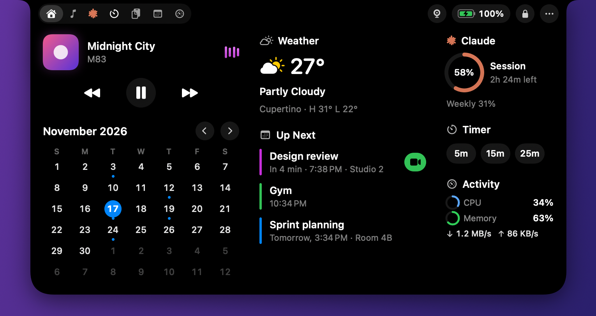
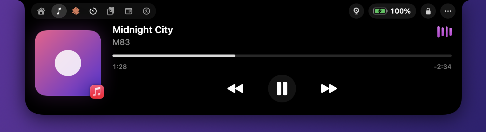
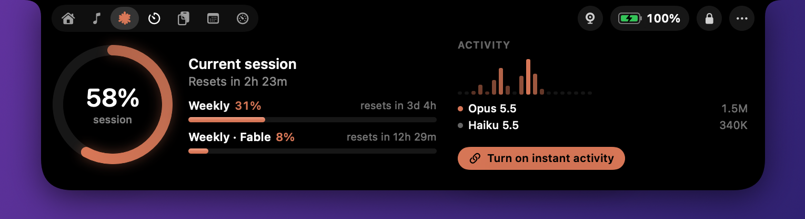
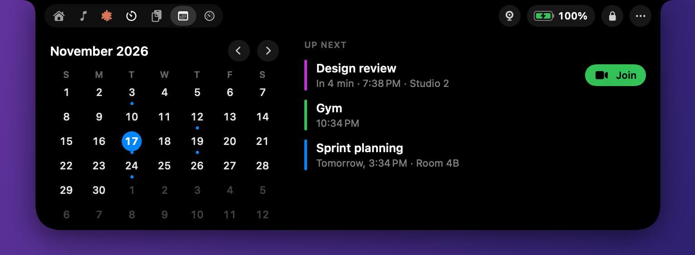
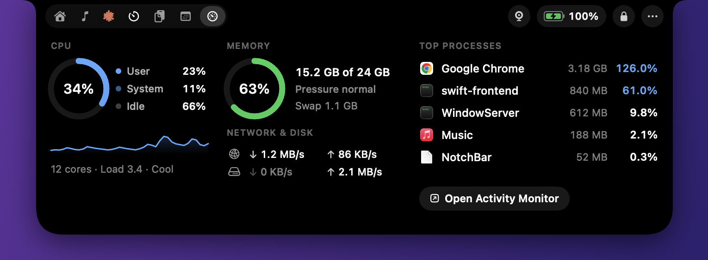
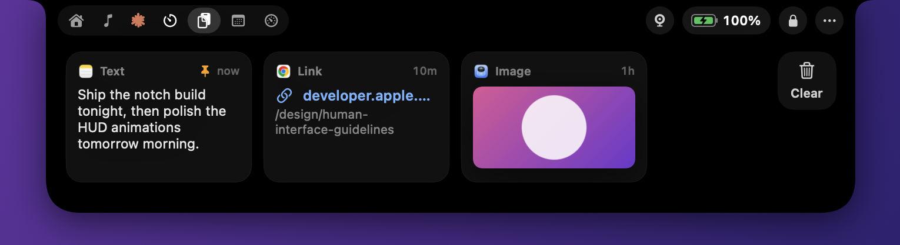
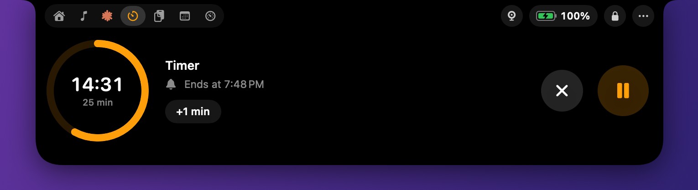
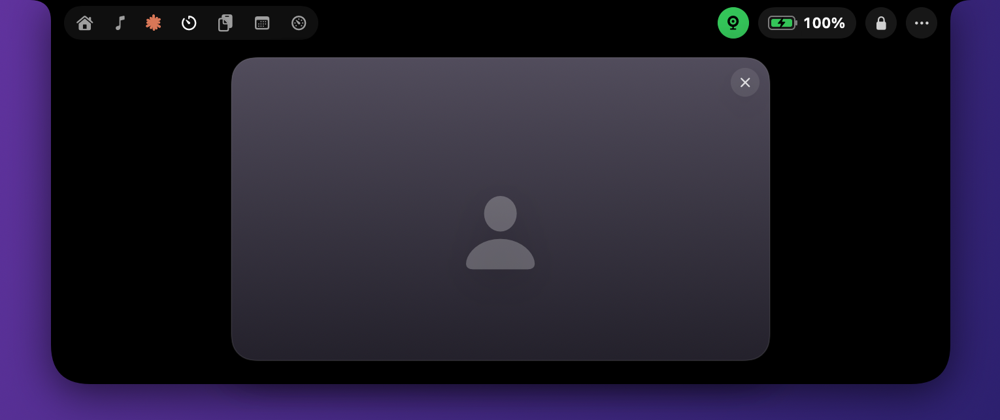
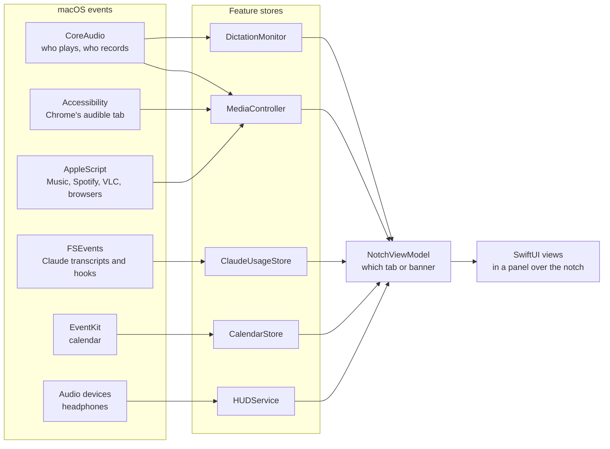

<div align="center">


# NotchBar

**Your MacBook notch, as a Dynamic Island.**

Music, meetings, Claude usage, system activity, timers, clipboard, headphones and a camera mirror, right where your camera is.
Native SwiftUI, no dependencies, and almost no battery.

[](https://github.com/srisanthosh/NotchBar/actions/workflows/build.yml)
[](https://github.com/srisanthosh/NotchBar/releases/latest)


[](LICENSE)



[Features](#features) · [Install](#install) · [Claude Code](#connect-claude-code) · [Performance](#performance) · [How it works](#how-it-works) · [FAQ](#faq) · [Contributing](#contributing)

</div>

---

## Why NotchBar

The notch is dead space on every modern MacBook. NotchBar puts it to work without getting in your way:

- **Glanceable.** The closed notch grows only as far as its content: a few waves when music plays, a Claude logo, a countdown.
- **One click away.** Hover for a small grow and a trackpad haptic. Click to open. Move away and it closes.
- **Native.** Spring animations, SF Symbols, system materials and haptics. No web views, no Electron.
- **Light.** 0.1% CPU at rest and 52 MB of memory, measured on the finished build. See [Performance](#performance).
- **Private.** Nothing leaves your Mac unless you turn on weather. NotchBar never reads passwords or tokens, and the camera is only on while you look at it.

## Features

### The closed notch

A status on each side of the camera, and nothing when there's nothing to say.

| | |
|:--|:--|
|  | **Now playing.** Waves tinted with the artwork's color. |
|  | **Claude.** A usage ring. The spark spins while Claude Code works and pulses amber when it needs you. |
|  | **Dictation.** Handy, Superwhisper, Wispr Flow, MacWhisper or VoiceInk, while it listens. |
|  | **Timer.** A live countdown. |

### Banners

Banners drop from the notch for a moment, then tuck back in.

| | |
|:--:|:--:|
| <br>**Headphones connect** with battery for each bud and the case. | <br>**Any earbuds** get the AirPods-style animation. |
| <br>**Meetings** 5 minutes ahead, with **Join** and **Snooze**. | <br>**Disconnects** say where your sound went. |
| <br>**New track** with artwork. | <br>**Volume and brightness** you can drag. |

### Tabs

<table>
<tr><td width="50%">

**Media.** Artwork, a scrubber and controls for whatever is playing.

- Music, Spotify and VLC show full track info.
- Chrome, Edge, Brave, Arc and Safari show the playing tab, and YouTube shows its thumbnail.
- Any other app shows its name and icon.
- Paused media stays on screen.

</td><td></td></tr>
<tr><td>

**Claude.** Your 5-hour session and weekly limits with reset times, an activity chart and a model breakdown. Live numbers come from Claude Code, and NotchBar estimates when they aren't available. See [Connect Claude Code](#connect-claude-code).

</td><td></td></tr>
<tr><td>

**Calendar.** The month at a glance and your next events, without the meetings you declined or that were canceled. Teams, Zoom, Meet and Webex links get a **Join** button. Click an event to open it in Calendar, or right-click for **Remind Me** and **Hide from Up Next**.

</td><td></td></tr>
<tr><td>

**Activity.** CPU, memory pressure, swap, network and disk, with the apps using the most CPU. It only measures while you're looking, and **Open Activity Monitor** is one click away.

</td><td></td></tr>
<tr><td colspan="2">

**Mixer.** This is the view the notch opens on. Faders are rounded pills, about 32 pt wide, for the system output and for each app that is playing, on macOS 14.4 and later. Idle apps are hidden until **Stumme Apps zeigen**, and then they stay grey. A crossfader under the strips shows the two loudest apps. It does not change audio until you move it off center or pick a side. Then it blends those apps with an equal-power curve, on top of each app's own level. Creating and tearing down a tap happens off the main thread, so a slow audio server cannot freeze the notch. The chevron under a strip picks an output, including AirPlay devices macOS is exposing. The master chevron changes the system output. A chosen device is remembered per app, and that app is tapped even at 100% so the sound can go there. If the device disappears, the app falls back to the default. At 100% with no custom output and no crossfade an app is left alone, and nothing is recorded or stored.

**Home.** Still there, from the tab bar. The song sits on the left; System and the apps that are playing sit on the right. If Core Audio has not marked an app yet, the Now Playing app is shown instead. Weather is a small chip. Claude, an agent, or a timer is one line when that extra is on and there is something to say. **… > Customize Home** turns cards on and reorders them. Hover opens the Mixer. Turn **Mixer beim Darüberfahren** off in Einstellungen to open Home instead.

**Ticker.** Off until **Einstellungen → Allgemein → Extras (Leistung)**. The detailed source switches appear after that. Sources are separate switches. **Dieser Mac** writes short German lines (an agent working, the app you have focused, new downloads, the Mac mini, a low battery, what is playing). Drop extra lines in as JSON files in `~/Library/Application Support/NotchBar/ticker/`:

```json
{"items":[{"text":"Build fertig: NotchBar.app","source":"build","priority":60,"url":"https://example.com","expires":"2026-11-24T18:00:00Z"}]}
```

**Nachrichten** reads the RSS list (ORF, Tagesschau, Reuters world, Hacker News) every five minutes. Headlines under 30 minutes old are marked BREAKING. A click opens the link. **X** stays hidden until a bearer token is saved in the Keychain from that same pane. The default search is `(breaking OR eilmeldung) -is:retweet lang:de OR lang:en`, polled about every five minutes, and only posts with a little engagement are shown.

**Einstellungen…** (also ⌘, while NotchBar is active) holds the switches that used to live in the … menu. The notch menu keeps Einstellungen, Mixer on Hover, Keep Awake, and Quit.

</td></tr>
<tr><td>

**Clipboard.** Your last 60 copies: text, links, images and files. Click to copy again, or paste, pin or delete, and **Clear** the whole history. Press <kbd>⌃</kbd><kbd>⌘</kbd><kbd>V</kbd> anywhere to open it. Password managers and concealed items are skipped.

</td><td></td></tr>
<tr><td>

**Timer.** Presets, pause, +1 minute, a countdown beside the notch, and a chime.

</td><td></td></tr>
</table>

<details>
<summary><b>And a few more things</b></summary>

- **Home.** Everything above on one page, plus weather. Each widget's title opens its full tab.
- **Dismiss anything.** Every banner can be put away: meeting reminders have a close button beside Snooze and Join, and the others show one when you hover.
- **Hide from screenshots.** **… > Hide from Screenshots** leaves the notch out of screenshots, screen recordings and shared screens.
- **Weather.** Off until you turn it on. It uses your approximate location and the free Open-Meteo service.
- **Tidy menu bar.** **… > Tidy Menu Bar Icons** tucks icons you rarely use behind a chevron, so the ones you need fit beside the notch. ⌘-drag an icon right of the thin divider to keep it visible.
- **Lock Screen** and battery level in the header.
- **Show only what you use.** Hide any tab from **… > Show Tabs**, and turn off banners you don't want from the same menu.
- **Appearance.** **… > Appearance…** is a live sheet: Black, Glass, Tinted Glass, or Gradient, an accent, type, size, corners, density, and fader shape. Presets are Midnight, Liquid Glass, Neon, Paper, and Pabo. Glass uses the system glass effect on macOS 26 and a blurred panel on earlier systems. The band that meets the hardware stays black.
- **Global Hotkeys.** Off until **… > Global Hotkeys**. Then ⌃⌥N opens or closes the notch, ⌃⌥M mutes the system output, and ⌃⌥S recalls the next saved scene.
- **Keep Awake.** **… > Keep Awake** holds an idle-sleep assertion. A cup icon shows in the notch while it is on. The display can still dim.
- **File Shelf.** Off until **… > File Shelf**. Drop files on the open notch to park them, click one to show it in Finder, or drag it back out.
- **Ducking.** Off until **… > Duck Other Apps**. Zoom, Teams, FaceTime, Webex, an optional browser Meet tab, or one chosen app lowers everything else to a quarter, then restores it.
- **Saved volumes.** **… > Apply Saved Volumes** puts an app back to its saved level, mute, and output when it starts playing. Off, a saved level still waits until you move that fader. An output chosen on a strip is remembered either way.
- **Spotify Connect.** Off until **Extras (Leistung)**. Setup is in [Spotify Connect](#spotify-connect). It polls only while that switch is on and the notch is open.
- **Mac mini.** Off until **Extras (Leistung)**. **Einstellungen → Integrationen** sets the SSH alias (default `mini`) once the switch is on. NotchBar runs `ssh -o BatchMode=yes` about once a minute while Home or the Mac mini ticker source is showing.
- **Portfolio.** Off until **Extras (Leistung)**. Holdings live in `~/Library/Application Support/NotchBar/portfolio.json`. **… > Portfolio › Edit Holdings…** creates a placeholder file (those amounts are examples, not yours) and opens it. Prices come from CoinGecko about every five minutes. A file `portfolio-status.json` in the same folder, with `total`, `change24hPct`, and `note`, replaces the calculated total when another tool writes it.
- **New audio.** **… > Expand on New Audio** is off, including if you already had NotchBar. A new track or app does not drop the now-playing banner or widen the closed notch. Turn it on for the old peek. Agent done and waiting banners are unchanged.

</details>

### Camera glance

<table>
<tr><td width="50%">

**A mirror in the notch.** Click the camera button beside the battery to see yourself in a live, mirrored view. Check your hair or your background before a call, then move on.

- The camera runs only while the view is on screen. It turns off when the notch closes, you pick a tab, or you click the button again.
- The button turns green while the camera is on.
- It uses your Mac's built-in camera, so an iPhone nearby isn't woken through Continuity Camera.
- Nothing is recorded or saved.

</td><td></td></tr>
</table>

## Install

### Download

1. Download the latest **NotchBar zip** from [Releases](https://github.com/srisanthosh/NotchBar/releases/latest), open it, and drag **NotchBar** into **Applications**.
2. Open it. macOS says it can't verify the app, because NotchBar isn't notarized by Apple. Click **Done**.
3. Open **System Settings › Privacy & Security**, scroll to **Security**, and click **Open Anyway** next to NotchBar.

### Build from source

You need macOS 14 or later and the Xcode Command Line Tools. Full Xcode isn't required.

```bash
xcode-select --install
```

```bash
git clone https://github.com/srisanthosh/NotchBar.git && cd NotchBar
```

Run this once. It creates a local signing certificate, so macOS remembers the permissions you grant across rebuilds:

```bash
scripts/setup-signing.sh
```

Then build and launch:

```bash
./build.sh --run
```

The app is built to `build/NotchBar.app`. Copy it to `/Applications` to use **Launch at Login** from the **…** menu.

<details>
<summary><b>Why the signing step?</b></summary>

Without it the app is signed ad hoc, and macOS treats every build as a new app. Accessibility, Automation and Calendar permissions would be forgotten each time you rebuild. The certificate stays in your login keychain and signs only NotchBar. If macOS asks whether `codesign` may use the key, choose **Always Allow**.

</details>

### Permissions, only when you need them

Nothing is asked for at launch. Each permission comes up the first time you use the feature that needs it.

| Feature | Permission | When it's asked |
|---|---|---|
| Track info from Music, Spotify, VLC and browsers | Automation, per app | The first time that app plays |
| Controlling browsers, instant pause detection in Chrome, paste, replacing the system HUD | Accessibility | When you first use one of them |
| Calendar tab and Up Next | Calendars | When you click **Allow** in the tab |
| Weather | Location | When you click **Show Weather** |
| Camera glance | Camera | The first time you click the camera button |
| Mixer | System audio recording | The first time you move a slider |
| Artist, artwork and progress from Chrome or Safari | **Allow JavaScript from Apple Events**, a browser setting | You turn it on yourself: Chrome's **View > Developer** menu, or Safari's **Develop** menu |

Detecting which app is playing, dictation and headphones need no permission at all. The mixer asks only after you move a slider, and only on macOS 14.4 or later.

## Spotify Connect

Off until **Extras (Leistung) → Spotify Connect**. NotchBar then lists the devices on your Spotify account, on the Spotify fader and under Now Playing. Tap one to move playback there. If the active device is a speaker or a phone rather than this Mac, a small volume slider controls that device.

Spotify needs a free app that you create. There is no shared client secret.

1. Open [developer.spotify.com/dashboard](https://developer.spotify.com/dashboard) and create an app.
2. Edit its settings and add this redirect URI exactly:

   `http://127.0.0.1:47321/callback`

3. Copy the Client ID.
4. Turn on **Extras (Leistung) → Spotify Connect**, open **Einstellungen → Integrationen**, paste the Client ID, and click **Anmelden**.

Sign-in uses Authorization Code with PKCE. The browser comes back to NotchBar on `127.0.0.1` port `47321`, and the tokens are stored in the Keychain. A 403 from Spotify, which is what a free account gets for Connect, shows “Spotify Connect needs a Premium account.”

## Connect Claude Code

Claude usage stays off until **Extras (Leistung) → Claude-Nutzung**. Until then NotchBar does not read `~/.claude/projects`. After you turn it on, it estimates usage from the transcripts Claude Code keeps there.

**For live limits and instant activity, connect it once:**

1. Open the notch and go to the **Claude** tab.
2. Click **Connect Claude Code**.
3. Use `claude` in Terminal once. Your real limits appear within seconds.

Connecting adds two small scripts to `~/.claude/settings.json`, and saves a backup of the file first. **… > Disconnect Claude Code** removes everything it added.

## Agent status

Off until **Extras (Leistung) → Agentenstatus**. With that on, the Agents card or the Agents ticker source watches Claude Code and Codex. The file watcher and the process check stay stopped until then. A running `claude` or `codex` process, or a transcript written in the last couple of minutes, shows as working or done. A status file is more precise: it can say the agent is waiting for you. When that changes to done or needs you, the notch plays a short chime and shows a brief banner.

Status files live in `~/Library/Application Support/NotchBar/agents/`. Any `*.json` file is read:

```json
{"id":"session-1","tool":"Claude","state":"waiting","title":"Needs your OK"}
```

`state` is `working`, `waiting`, or `done`. A Claude Code hook can write one. Add this to `~/.claude/settings.json` (merge it with the hooks you already have):

```json
{
  "hooks": {
    "Notification": [{ "hooks": [{ "type": "command", "command": "mkdir -p \"$HOME/Library/Application Support/NotchBar/agents\" && printf '%s' '{\"id\":\"claude\",\"tool\":\"Claude\",\"state\":\"waiting\"}' > \"$HOME/Library/Application Support/NotchBar/agents/claude.json\"" }] }],
    "Stop": [{ "hooks": [{ "type": "command", "command": "mkdir -p \"$HOME/Library/Application Support/NotchBar/agents\" && printf '%s' '{\"id\":\"claude\",\"tool\":\"Claude\",\"state\":\"done\"}' > \"$HOME/Library/Application Support/NotchBar/agents/claude.json\"" }] }]
  }
}
```

Codex can use the same folder. Point a Codex `Stop` hook, or a small wrapper you already run when a task finishes, at `~/Library/Application Support/NotchBar/agents/codex.json` with `"tool":"Codex"`. NotchBar does not install these hooks for you.

| What you get | Terminal `claude` | Desktop app and VS Code |
|---|:--:|:--:|
| Spinner starts and stops the moment Claude does | ✅ | ✅ |
| Amber pulse when Claude needs your approval | ✅ | ✅ |
| Real 5-hour and weekly limit percentages | ✅ | Last reading from Terminal |
| Estimated session usage, calibrated to your plan | ✅ | ✅ with **Match Claude** |

Why the difference? Claude Code reports plan limits only to its status line, and only the terminal version runs a status line. The Claude apps read your limits from Anthropic with your sign-in, which NotchBar never touches. The activity hooks run everywhere.

**How the estimate works.** When there's no current reading, NotchBar adds up what each reply cost from the transcripts, weighing tokens the way the API prices them (output 5×, cache writes 1.25×, cache reads 0.1×, smaller models less). Each real reading teaches it what one percent of your plan costs, and when your window started. The ring then says **est. session**, and the footer says where the scale came from.

**Only use the desktop app or VS Code?** Click **Match Claude** in the Claude tab footer (or **… > Match Claude's Usage…**) and type in the two numbers from Claude's **Account & Usage** window: the Session (5hr) percentage and its reset time. That's all the estimate needs.

Estimates drift when you also use Claude elsewhere, such as claude.ai or another Mac, because NotchBar only sees this Mac's Claude Code. That use counts toward the same limit and can start a window earlier. Match again, or use `claude` in Terminal, to line it back up.

<details>
<summary><b>I already have my own status line</b></summary>

NotchBar leaves an existing status line alone. To feed it from your script, add this line where your script has read its input into `$input`:

```bash
printf '%s' "$input" | jq -c '{rate_limits: .rate_limits, updated_at: now}' > ~/.claude/notchbar/limits.json
```

</details>

<details>
<summary><b>What exactly gets installed?</b></summary>

- `~/.claude/notchbar/activity.sh` runs on the `UserPromptSubmit`, `Stop`, `SessionEnd` and `Notification` hooks. It writes one tiny marker file per busy session and prints nothing, so it never adds to Claude's context.
- `~/.claude/notchbar/statusline.sh` is the status line. It saves the `rate_limits` Claude Code sends to `limits.json`, and draws a compact status line with your model and limits.

Some plans report only the 5-hour window. Then the weekly area shows this week's token count.

</details>

## Performance

NotchBar is built to run all day on battery. These numbers are from the finished build on an M-series MacBook Pro, measured with `top` while Claude Code was working and its spinner animating:

| Measure | Result |
|---|---|
| CPU at rest, over 60 seconds | **0.1%** |
| CPU with the notch open on Home | **0.0%** |
| Wakeups at rest | **10 per minute** |
| Memory footprint | **52 MB** |
| Launch | **0.15 s** |
| App size | **4.5 MB** |

Measure it yourself:

```bash
top -l 2 -s 60 -pid $(pgrep -x NotchBar) -stats pid,cpu,idlew,power,mem | tail -1
```

<details>
<summary><b>What made the biggest difference</b></summary>

| Change | Before | After |
|---|---|---|
| A sensor window over the notch instead of watching every mouse move | 50 wakeups a second while you use the mouse | none |
| Microphone checks triggered by events instead of a timer during calls | 1.5% CPU | 0% |
| The Claude spinner as a Core Animation layer instead of a SwiftUI rotation | 8% CPU | 0% |

</details>

## How it works



- **Events instead of polling.** CoreAudio reports when any app's audio starts or stops. Music and Spotify post change notifications. FSEvents reports transcript and hook changes. DisplayServices reports brightness, and IOKit reports battery.
- **Polling only where macOS offers nothing else, and only while needed.** Browser tabs and VLC are checked while they play. The clipboard change counter is one cheap call every half second. Activity reads the kernel's counters only while its tab or the Home widget is on screen.
- **The pointer costs nothing until it reaches the notch.** A nearly invisible sensor window over the notch gets one event when the pointer arrives. NotchBar follows the pointer only while it's on the notch or the notch is open.
- **Animations run in the compositor.** The window server animates the waves and the Claude spinner with no CPU from NotchBar.
- **Everything pauses** while the displays sleep or the Mac is locked.
- **Incremental reads.** Transcripts are append-only, so only new lines are read. The scan does not run at launch. It starts only after **Extras (Leistung) → Claude-Nutzung**.

<details>
<summary><b>Notes on macOS quirks, for contributors</b></summary>

- On current macOS, CoreAudio never sends change notifications for a process's "running output" and "running input" flags, though the values change. It does notify for the general "running" flag and for devices, so NotchBar listens to those and then reads the flags.
- Chrome names each tab in its tab strip "Title" followed by status notes in any order, such as "– Audio playing" and "- Memory usage - 462 MB". The audible marker isn't always last.
- Chrome holds its audio stream open about 15 seconds after a pause, so pause detection reads the tab strip instead.
- Connecting headphones restores their saved volume, which reports a volume change. Device banners outrank the volume HUD so they aren't replaced.
- Per-app volume installs a process tap only while a slider isn't at 100%, the app is muted, or that app is routed to a chosen output. Otherwise the tap is removed, so the app plays as it does without NotchBar. If the tap can't start, it is torn down and the app is left at its normal volume.
- TCC permissions belong to the responsible process. Launch NotchBar with `open`, not from a terminal, when testing permissions.

</details>

## Privacy

- **Stays on your Mac.** Everything NotchBar reads stays on your Mac. The only network request is weather, once you turn it on, and the location it sends is rounded to about a kilometre.
- **No content.** NotchBar sees that an app uses the microphone, never what it hears.
- **Camera.** The camera runs only while the camera glance is on screen. Nothing is recorded or saved.
- **Mixer.** Turning an app down, or sending it to another output, listens to that app so it can be played quieter or on that device. Nothing is recorded or stored. An app at 100% on the default output isn't listened to.
- **No secrets.** NotchBar never reads passwords, tokens or keychain items.
- **Clipboard.** Concealed items and password managers are skipped.

## FAQ

<details>
<summary><b>The Claude ring shows "est. session". Is it connected?</b></summary>

Yes, if the footer doesn't offer **Connect Claude Code**. "est." means the number is NotchBar's estimate, because there's no current real reading. Use `claude` in Terminal once, or click **Match Claude** and type in what Claude's Account & Usage window shows.

</details>

<details>
<summary><b>NotchBar's percentage differs from the Claude app's.</b></summary>

The Claude app shows your exact usage across everything: Claude Code, claude.ai and other devices. NotchBar estimates from this Mac's Claude Code transcripts. Click **Match Claude** to line the two up. A terminal `claude` reading does the same on its own.

</details>

<details>
<summary><b>Chrome shows the tab title but no artist or progress.</b></summary>

Turn on **View > Developer > Allow JavaScript from Apple Events** in Chrome. In Safari, the same setting is in the **Develop** menu. NotchBar then reads the page's media session.

</details>

<details>
<summary><b>My headphones show no battery.</b></summary>

AirPods and Beats report each bud and the case to macOS. Many other headphones report battery only to Control Center's Bluetooth menu, which other apps can't read. Their banner still shows the connection and volume.

</details>

<details>
<summary><b>The status line doesn't update on macOS 14.</b></summary>

The status line script uses `jq`, which ships with macOS 15 and later. On macOS 14, install it with `brew install jq` and edit the path in `~/.claude/notchbar/statusline.sh`.

</details>

<details>
<summary><b>Does it work without a notch?</b></summary>

Yes. On a Mac without a notch, NotchBar draws a small pill under the menu bar.

</details>

## Development

<details open>
<summary><b>Useful commands</b></summary>

Render every state to PNG with sample data, for reviewing design changes:

```bash
swift build -c release && .build/release/NotchBar --snapshot ./snapshots
```

Regenerate the README screenshots from those snapshots:

```bash
swift scripts/crop-screenshots.swift ./snapshots docs/screenshots 00-home 09-media 13-claude-live
```

Print the usage NotchBar reads from your transcripts:

```bash
.build/release/NotchBar --usage
```

Drive a running copy from the command line. Start it with `open --env NOTCHBAR_DEBUG=1 build/NotchBar.app`, then:

```bash
scripts/debug.sh open:claude
```

Other commands include `airpods`, `buds`, `meeting`, `volume`, `shot:/tmp/notch.png` and `state:/tmp/state.json`. See `App/DebugCommands.swift` for all of them.

Regenerate the app icon after changing `App/AppIcon.swift`:

```bash
.build/release/NotchBar --make-icon Resources/AppIcon.iconset && iconutil -c icns Resources/AppIcon.iconset
```

</details>

### Project layout

```
Sources/NotchBar/
  App/        Entry point, wiring, and developer tools
  Notch/      The window, the pointer sensor, the shape, and the open and closed layouts
  Features/   One folder per feature, each with a store or controller and its views
    Media/      What's playing: CoreAudio activity, player scripts, browser tabs
    Claude/     Transcript scanner, Claude Code integration, usage panel
    Home/       The master page and its compact widgets
    Calendar/   EventKit store, calendar panel, meeting reminders and snooze
    Activity/   CPU, memory, network, disk and top processes, sampled while visible
    Camera/     The camera glance, running only while it's visible
    Weather/    Opt-in weather from Open-Meteo
    MenuBar/    The menu bar organizer
    Dictation/  Shows dictation apps like Handy while they listen
    Clipboard/  Clipboard history
    Timer/      Countdown timer
    HUD/        Volume, brightness, headphones, and the optional key takeover
    Mixer/      Per-app volume. No taps until a slider moves off 100%, or an app has its own output
  Shared/     Small helpers: sleep-aware timer, file watcher, controls, formatting
```

Each feature has the same shape. A `@MainActor` `ObservableObject` owns the state and does the work, and SwiftUI views observe it. `NotchViewModel` decides which tab or banner shows. `NotchController` keeps the window over the notch and handles the pointer.

## Roadmap

- [x] Now playing from any app, with browser tabs
- [x] Claude usage with live limits and instant activity
- [x] Calendar with Join and Snooze
- [x] Clipboard history
- [x] Headphones, dictation, volume and brightness banners
- [x] Activity monitor
- [x] Camera glance
- [ ] Notifications in the notch
- [ ] More Live Activities
- [ ] A <kbd>⌘</kbd><kbd>K</kbd> command palette

## Contributing

Issues and pull requests are welcome, including your first ever open source contribution. The [contributing guide](CONTRIBUTING.md) walks you through setting up your Mac, making a change and opening a pull request.

- 🐛 [Report a bug](https://github.com/srisanthosh/NotchBar/issues/new?template=bug_report.yml)
- 💡 [Suggest a feature](https://github.com/srisanthosh/NotchBar/issues/new?template=feature_request.yml)
- 🔒 [Report a security problem privately](SECURITY.md)

The short version: keep it native and dependency-free, use system events rather than timers, check your change with `--snapshot`, and measure anything that runs in the background. Everyone taking part follows the [Code of Conduct](CODE_OF_CONDUCT.md).

## License

Copyright © 2026 Sri Santhosh N.

NotchBar is free software under the [GNU General Public License v3.0](LICENSE). You can use, study, change and share it. If you share a changed version, or an app built from this code, you must release its source code under the same license.

**Name and icon.** The license covers the code, not the NotchBar name or its icon. If you publish a fork, give it its own name and icon, so nobody mistakes it for NotchBar.
